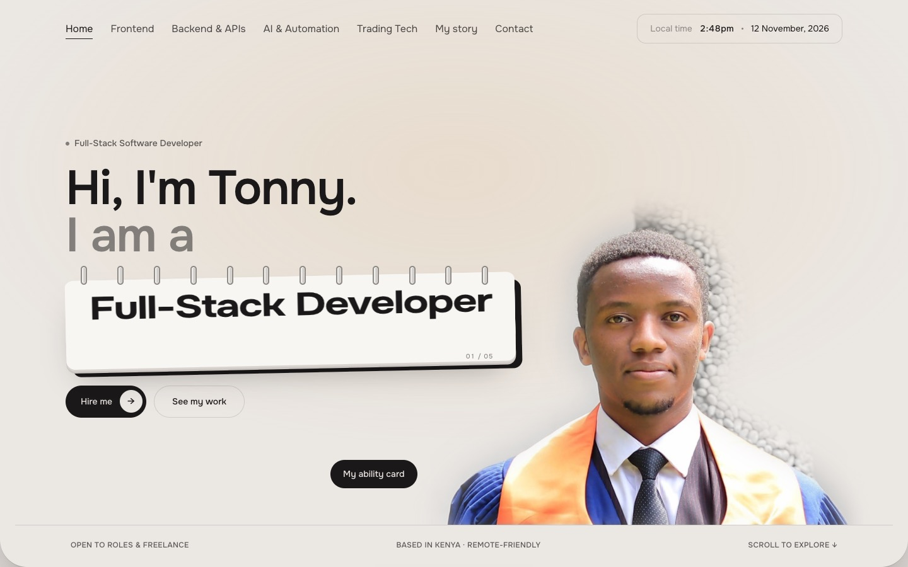
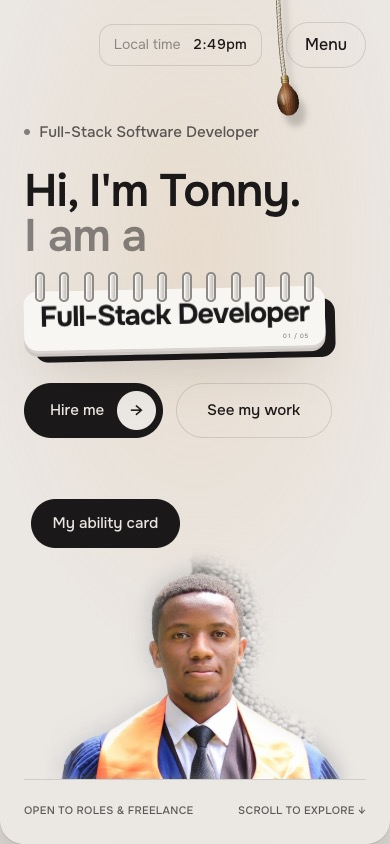
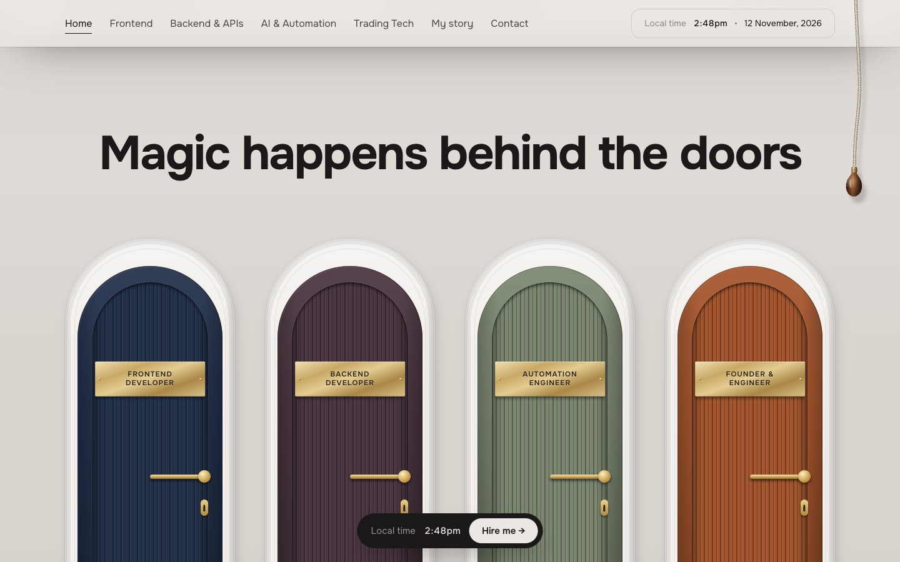
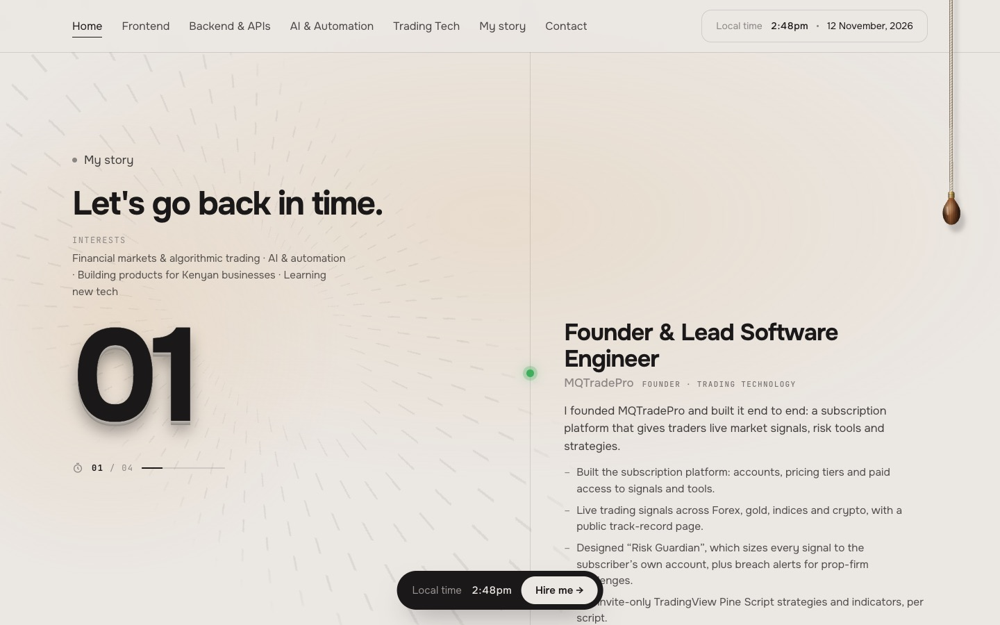
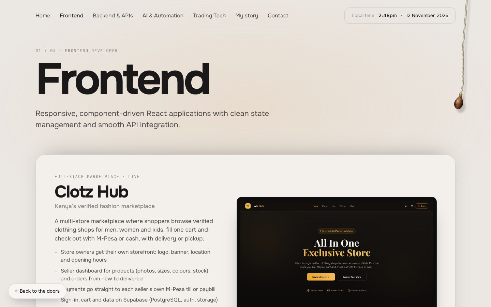
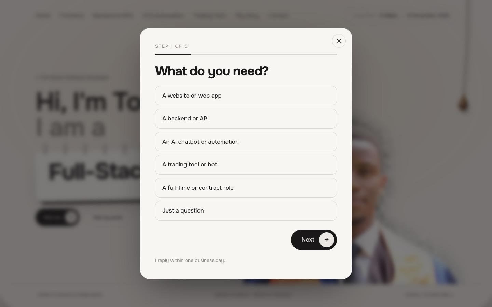
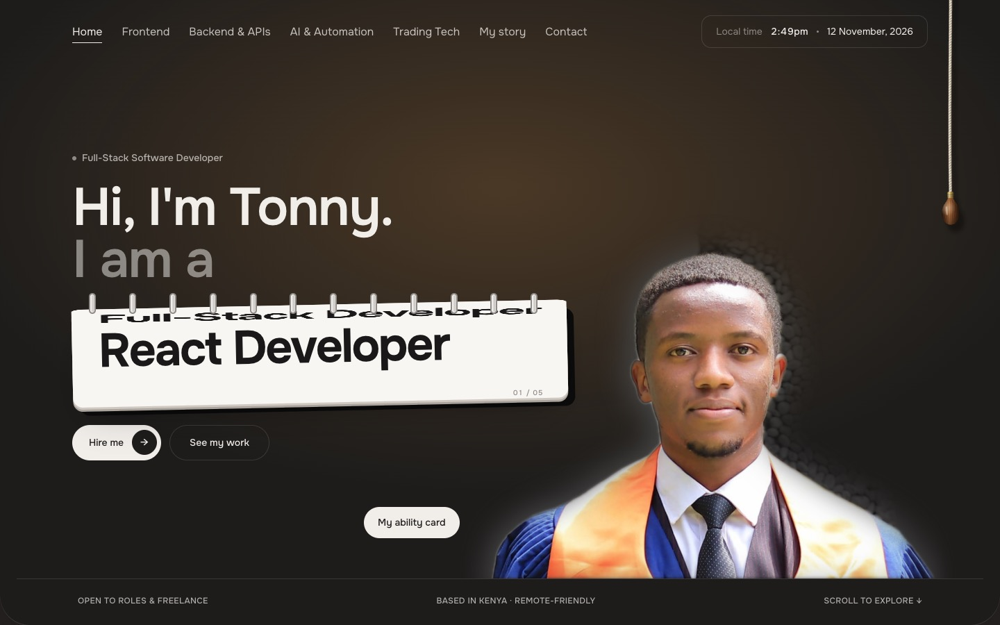
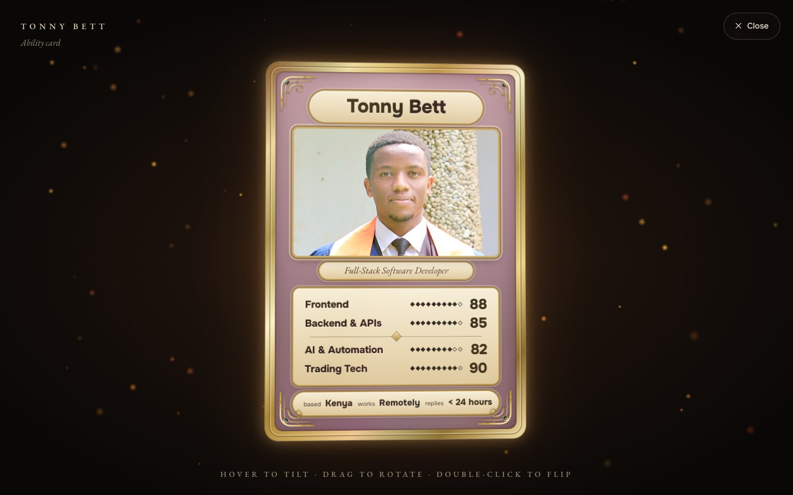
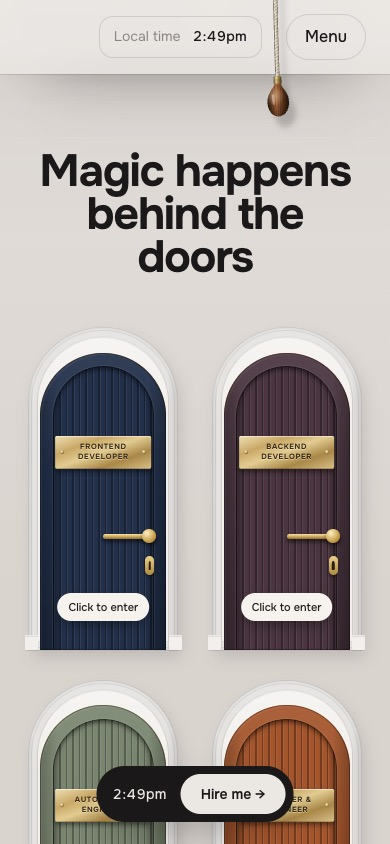
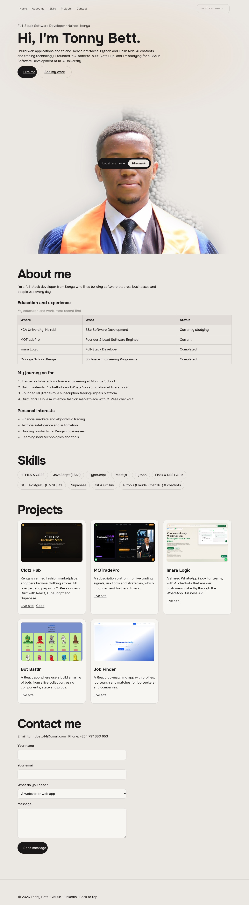

# Personal Portfolio: Tonny Bett

My personal portfolio website as a full-stack software developer in Kenya. It introduces me, shows my skills and projects, and lets visitors contact me. It's built with **HTML and CSS**, with JavaScript added for the interactive features. There are no frameworks and no build step.

- **Live site (GitHub Pages):** https://bett-001.github.io/personal-portfolio/
- **Mirror (Vercel):** https://tonnisportfolio.vercel.app/

Built for **CSN 1101: Web Technologies and Internet Applications, CAT 2**, KCA University.

## Sections

| Section | What it contains |
|---|---|
| **Home** | My name, profile picture and a short introduction |
| **About me** | Education and experience (a table), my journey (an ordered list) and personal interests (an unordered list) |
| **Skills** | Ten technical skills, plus four "skill doors" that open onto each area of my work |
| **Projects** | Five projects with screenshots and live links: Clotz Hub, MQTradePro, Imara Logic, Bot Battlr and Job Finder |
| **Contact** | My email address and phone number, and a contact form (name, email, topic and message) |

## How it meets the brief

**HTML (`index.html`).** Document structure, headings and paragraphs, images, hyperlinks, an ordered list, unordered lists, a table with a caption and header cells, a form with labelled `input`, `select` and `textarea` fields, and the semantic elements `header`, `nav`, `main`, `section`, `article` and `footer`.

The whole portfolio is written in plain HTML, so it works with JavaScript turned off. When JavaScript runs, `js/main.js` replaces it with the interactive version.

**CSS (`style.css`, one external stylesheet).**
- Background colours, with a light and a dark theme.
- Google Fonts: Onest, JetBrains Mono and EB Garamond.
- Styled headings, paragraphs and navigation links.
- Classes and IDs, margins, padding and borders.
- **Flexbox** (hero, navigation, skill chips) and **CSS Grid** (skill doors, project cards, contact form).
- Hover effects on navigation links, buttons, cards and the doors.
- Responsive layouts for phones and tablets using media queries.

**Extra interactive features (JavaScript).**
- An opening intro.
- A role flip-card.
- A physics pull cord that switches between light and dark mode.
- Skill doors that open on hover.
- A scrolling story timeline.
- A 3D ability card you can tilt and flip.
- A 5-step "Hire me" form.

## Project structure

```
index.html     the page: header, nav, main (all sections), footer, dialogs
style.css      all styles
images/        profile photos and project screenshots
js/content.js  the text and data used by the interactive version
js/main.js     routing, intro, doors, story timeline, contact form
js/cord.js     the pull-cord light/dark switch
js/card.js     the 3D ability card
screenshots/   screenshots of the finished website
```

## Testing

Tested on 12 November 2026 with Google Chrome, at desktop (1440 × 900) and mobile (390 × 844) sizes.

| Check | Result |
|---|---|
| Navigation links: Home, About, Skills, Projects, Contact, the four skill pages and Privacy | ✅ All open the right page or section |
| Images | ✅ All display, with 0 broken images and 0 failed requests |
| Desktop layout | ✅ Works |
| Mobile layout | ✅ Works, with no sideways scrolling |
| Light and dark mode | ✅ Both work |
| With JavaScript turned off | ✅ The full plain-HTML portfolio shows |
| JavaScript console | ✅ No errors |
| **HTML:** W3C Nu HTML Checker (validator.w3.org) | ✅ **0 errors, 0 warnings** |
| **CSS:** W3C CSS Validator (jigsaw.w3.org), CSS level 3 + SVG | ✅ **0 errors** |

## Screenshots

| | |
|---|---|
|  Home (desktop) |  Home (mobile) |
|  Skill doors |  About me and my story |
|  Projects |  Contact form |
|  Dark mode |  3D ability card |
|  Skill doors (mobile) |  Plain-HTML version (JavaScript off) |

## Run it locally

Open the folder in VS Code, right-click `index.html` and choose **Open with Live Server**. Or run `python3 -m http.server` and open http://localhost:8000.

## Credits

- **Fonts:** Onest, JetBrains Mono and EB Garamond (SIL Open Font License), served by Google Fonts.
- **Design inspiration:** the layout and interaction ideas (doors, pull cord, flip-card roles, ability card) are inspired by [therishithakor.com](https://therishithakor.com) by Rishi Thakor. All the code here is written from scratch, and all text and photos are my own.

© 2026 Tonny Bett
